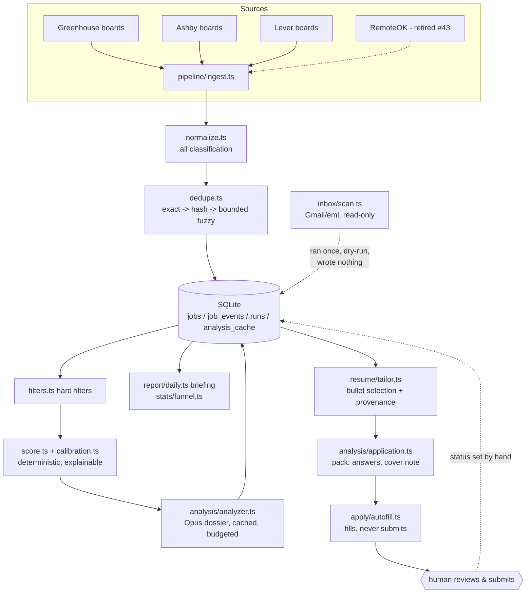
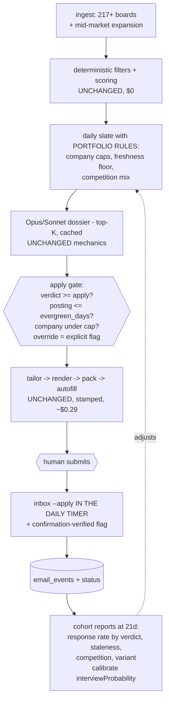

# Architecture Audit - 2026-08-24

Audit of the full pipeline: architecture, effectiveness, AI usage, cost, and reliability.
Every number in this document was measured against `data/job-radar.sqlite`, the run log,
the `applications/` directory, or the source tree on 2026-08-24. Where a claim could not
be verified, it is marked as such. Nothing here is taken from documentation on trust.

---

## 1. Executive Summary

The audit premise was: unreliable, ineffective, $15-20 per application, zero responses
from ~50 applications. Three of those four claims do not survive contact with the data,
and the fourth has a different cause than assumed.

**What is actually failing, ranked:**

1. **The outcome feedback loop was built, works, and has never been switched on.**
   `inbox` (JOB-42) ran exactly once, on 2026-08-20, **without `--apply`** - which is
   the report-only default. It fetched 5 messages and identified 2 valid status
   transitions, then discarded everything, because dry-run writes nothing. `email_events`
   has 0 rows. Every funnel metric (`APPLIED -> SCREEN: 0%`) is reporting **missing
   data, not measured silence**. Responses exist; the system saw them once and forgot.

2. **The apply path has no discipline gate.** Of 43 submitted applications, only
   **16 had an analyst "apply" verdict**. 16 went to jobs the analyst explicitly rated
   `network_or_watch`, and 11 were never analyzed at all. The tool prepares documents
   for any job id it is handed; nothing in `resume tailor`, `apply`, or `autofill`
   blocks or even requires confirmation when the verdict is absent or negative
   (`src/cli.ts:260` is a warn, not a gate).

3. **The applied portfolio is concentrated exactly where competition is worst, on
   exactly the stalest postings.** 43 applications across only 22 companies (4x Samsara,
   4x Customer.io, 3x each Vercel/Vanta/Sanity/Render/Hightouch), all famous AI/devtools
   brands. Of the 32 analyzed, 31 were rated `high` or `very_high` competition.
   **24 of 43 applications went to postings older than 45 days (mean 250 days old)**;
   only 8 went to postings under 3 weeks old. The system's own analyst predicted this
   outcome: mean estimated interview probability 22.5%, i.e. ~7 expected interviews
   *over a full response cycle* - and the median application is currently 5-6 days old.

4. **Cost is already solved and was never $15-20 per application.** Total recorded
   lifetime model spend is **$23.43**. Marginal cost per fully prepared application
   today is **~$0.33** (analysis $0.044 + resume plan $0.193 + pack $0.093). The
   $15-20 figure appears to descend from one real event, already documented in
   `src/lib/cost.ts`: a ~$17 *day* on which 61 `tailor`/`apply` runs recorded $0
   because cost logging did not exist for them yet. That was fixed on 2026-08-19.
   A per-day number got remembered as a per-application number.

**One premise correction that matters architecturally:** the system has never submitted
an application. `autofill` fills and stops by design (CLAUDE.md non-negotiable; the
browser test suite asserts submit is never clicked). A human submitted all 43.
"Submission verification" therefore cannot mean browser assertions; it means capturing
the confirmation emails the inbox scanner already classifies (`confirmation only`,
`src/inbox/scan.ts:110`) and recording them against the job.

**The one-line diagnosis:** this is not a cost problem or a reliability problem. It is
a *targeting discipline* problem compounded by a *dark feedback loop*. The pipeline
prepares good documents cheaply for the wrong jobs and cannot learn better because its
outcome sensor was never plugged in.

---

## 2. Current Architecture (verified against code)

The README's architecture section matches the code. The design rules claimed in
CLAUDE.md are real and enforced in code and tests:

| Claimed | Verified |
|---|---|
| Adapters are dumb; classification only in `normalize.ts` | Yes (`src/pipeline/normalize.ts`, `tests/sources.test.ts`) |
| One failing source never aborts a run | Yes, per-adapter catch + `ctx.stats`, pinned by test |
| Determinism boundary (no LLM for arithmetic/parsing) | Yes; scoring/dedupe/filters are pure code |
| Structured output: JSON Schema + Zod revalidation | Yes (`analysis/schema.ts`, `AnalysisSchema`) |
| Resume provenance enforced, rewrites reverted | Yes (`resume/provenance.ts`, `enforceProvenance` in render path) |
| Never auto-send / autofill never submits | Yes; asserted by `tests/autofill.browser.test.ts` in default `npm test` |
| Content-addressed analysis cache + prompt caching | Yes (`analysis_cache`, `cache_control: ephemeral`) |
| Spend caps | Yes (`--limit`, `max_spend_per_run_usd`, `--max-spend`) |
| Reuse of tailor/pack via stamps | Yes (`apply/reuse.ts`), **but only 31 of 47 application dirs have `generation.json`** |

This codebase is not the naive LLM-spaghetti system the mission brief assumed. The
requested architecture (staged funnel, state machine, canonical profile, structured
validation, event log, run telemetry) substantially **already exists**. The audit's
findings are about the gaps between the parts, not about missing parts.

## 3. Current Application Pipeline (actual end-to-end flow)

| Stage | Command | Inputs | Outputs / side effects | Model? | Cost |
|---|---|---|---|---|---|
| Discovery | `ingest` (daily timer) | 217 board tokens in `config/sources.yaml` | `jobs` rows, `job_events: discovered` | No | $0 |
| Normalize/classify | inside ingest | provider payloads | remote status, seniority, salary, location | No | $0 |
| Dedupe | inside ingest | dedupe_key, description hash, fuzzy | merged rows; description change invalidates cached analysis | No | $0 |
| Hard filters | `score` | career-profile.yaml | `filter_passed`, reasons | No | $0 |
| Scoring | `score` | signals/combos/lanes config | fit_score, ROI, lane, explanation | No | $0 |
| Deep analysis | `analyze` (manual) | top-K by rank among eligible | `analysis_json` validated, cached | Opus-5 | $0.044/job (measured: avg 2,445 in / 1,262 out) |
| Briefing | `daily` (timer) | scored + analyzed index | `reports/` briefing, funnel | No | $0 |
| Resume plan | `resume tailor` | resume.yaml + posting | `resume-plan.json` (bullet ids only), stamped | Opus-5 | $0.193/generation (measured) |
| Render | `resume render` | plan + master resume | HTML/MD/PDF, provenance re-checked | No | $0 |
| Pack | `apply` | posting + profile | `pack.json`: form answers, cover note, keywords; `--full` adds outreach/interview prep | Opus-5 | $0.093/generation (measured) |
| Autofill | `autofill` | pack + personal.yaml | fills employer form, screenshots, report; **stops before submit** | No | $0 |
| Submit | **human** | - | status set to APPLIED by hand | - | - |
| Outcomes | `inbox` | Gmail (read-only) or .eml dir | email_events + status transitions | No | $0 |
| Ghost sweep | `daily` | elapsed time | GHOSTED transitions | No | $0 |

Failure modes, retries, idempotency: per-source error isolation (tested); `PoliteFetcher`
rate limiting; analysis failures recorded per job (`analysis_failures`,
`failure_kind`) with parking; tailor/pack idempotent via stamps since 2026-08-19;
`withRepo` records every run (ok flag + stats) into `runs` - 23 distinct commands logged.

## 4. Critical Findings

### P0 - product failure

| ID | Finding | Evidence |
|---|---|---|
| P0-1 | Outcome loop dark: inbox never run with `--apply`; 2 found transitions discarded; `email_events` empty; all funnel outcome metrics are null measurements | `runs` 2026-08-20T16:16 `{"fetched":5,"transitioned":2}`; `SELECT COUNT(*) FROM email_events` = 0; `--apply` defaults false (`src/cli.ts` inbox command) |
| P0-2 | No gate between analysis verdict and application: 27/43 applications lacked an "apply" verdict (16 watch, 11 unanalyzed) | jobs where status=APPLIED joined to analysis_json |
| P0-3 | 24/43 applications to postings >45 days old (mean 250d); freshness machinery exists (`model/freshness.ts`, evergreen_days) but is not consulted on the apply path | date_posted vs status_changed_at |
| P0-4 | Portfolio concentration: 22 companies, all high-heat brands; 31/32 analyzed rated high/very_high competition; multiple same-company applications within days (4x Samsara, 4x Customer.io) | applied-set queries |

### P1 - major architectural problem

| ID | Finding | Evidence |
|---|---|---|
| P1-1 | Discovery pool itself is concentration-biased: top-10 companies are 34.5% of the 12,799-job index (OpenAI 819, Databricks 735, Stripe 540, Anthropic 531). The v1 lesson "famous companies = no differentiation" is documented in `src/sources/discover.ts` and not applied to the current board list | company counts; discover.ts docstring |
| P1-2 | Cost telemetry has a permanent blind spot for the pre-2026-08-19 era and no per-application rollup; `spend` labels itself lower-bound but early $0 rows still mislead | cost.ts docstring; runs stats keys |
| P1-3 | 16/47 application dirs predate stamps; a re-run of `tailor` on those would silently regenerate and replace potentially submitted documents | `ls applications/*/generation.json` = 31 |
| P1-4 | Daily timer runs ingest/score/ghost/briefing but not `inbox`; outcome capture depends on a human remembering a command whose default discards its own results | `deploy/job-radar-daily.service` |
| P1-5 | The "zero responses" conclusion was drawn at median application age 5-6 days, below any realistic response latency, while 5 unprocessed mailbox messages existed | applied dates 08-13..08-19; inbox run |

### P2 - important improvement

| ID | Finding |
|---|---|
| P2-1 | `missingRequirements` already distinguishes MANDATORY DOMAIN vs LEARNABLE TOOL, but as free text inside strings; not queryable as required-vs-preferred structure |
| P2-2 | Submission confirmation emails are classified (`confirmation only`) but produce no persistent verification state (no APPLIED-confirmed flag) |
| P2-3 | Analyst `interviewProbability` is never calibrated against outcomes (blocked on P0-1; `calibration.ts` already does exactly this for the keyword engine) |
| P2-4 | Model-tier policy is implicit: everything paid runs on Opus-5. A Sonnet-5 dossier agreement benchmark (reusing `benchmark.ts`) has never been run |

### P3 - hygiene

Stray empty `data/jobs.db`; 13 `personal.yaml.*.bak` files littering `config/`;
README still lists RemoteOK as an active adapter (retired in #43).

## 5. AI Cost Audit

Every model call site in the codebase (grep for Anthropic client): `analysis/analyzer.ts`,
`analysis/prepare.ts` (triage tier, benchmark-gated off), `analysis/benchmark.ts`,
`resume/tailor.ts`, `resume/import.ts` (one-time), `resume/init.ts` (one-time),
via `analysis/application.ts` for packs. There are no hidden calls; nothing else touches
the API.

| Stage | Calls (lifetime) | Model | Avg in | Avg out | Measured cost | Necessary? | Replacement |
|---|---:|---|---:|---:|---:|---|---|
| Analysis dossier | 430 | opus-5 | 2,445 | 1,262 | $0.044/job, $18.82 lifetime | Yes (semantic fit) | Benchmark sonnet-5 (~40% cut); triage tier exists but its own benchmark said not yet |
| Resume plan | ~47 + reruns | opus-5 | 7,390 | 6,565 | $0.193/generation | Yes (bullet selection) | Keep; already reused via stamps |
| Application pack | ~47 + reruns | opus-5 | n/a | ~6k | $0.093/generation | Yes (answers/cover note) | Keep; `--full` sections already opt-in |
| Resume import/init | one-time | opus-5 | - | - | negligible | One-time | - |
| Everything else | 0 | - | - | - | $0 | Deterministic already | - |

**Totals:** recorded lifetime $23.43 (`spend`). Pre-instrumentation tailor/apply spend
unrecorded; bounded estimate from the one measured $17 day and re-run counts: $30-60.
**Best-estimate lifetime bill: $55-85 for 47 prepared applications, ~$1.20-1.80/app
all-in historical, ~$0.33/app marginal today.**

**Answer to "why $15-20/application":** it never was. One pre-instrumentation ~$17 *day*
(61 invisible tailor/apply runs re-running at effort:high after chain failures, since
fixed by stamps) plus, plausibly, an Anthropic console total that includes interactive
Claude Code development sessions, which are not pipeline costs. The four cost mechanisms
in CLAUDE.md are intact and working.

### Target economics (already achieved or near)

| Metric | Current measured | Target |
|---|---|---|
| Discovery + scoring per job | $0 | $0 |
| Analysis per analyzed job | $0.044 | <=$0.05 (or ~$0.026 on sonnet if benchmark passes) |
| Docs per submitted application | $0.286 | <=$0.30 |
| Total marginal per application | ~$0.33 | <=$0.50 |
| Per 100 applications (incl. 3x exploration analyses) | ~$45 | <=$60 |
| Monthly at current cadence | ~$25-50 | <=$50 |

Cost is not the constraint. Below ~$1/application, further token optimization is
premature against a 0%-measured response rate; the optimization target is responses.

## 6. Application Effectiveness Audit

Why ~zero responses from 43 applications, decomposed:

1. **Not yet measurable (dominant factor).** Median application age 5-6 days at audit
   time; 16 applied on 08-18 and 19 on 08-19. Typical first-response latency is 1-3
   weeks. The analyst's own estimates sum to ~7.2 expected interviews over a full cycle;
   the expected count *by day 6* is a fraction of that.
2. **Provably not zero.** The single inbox dry-run matched 2 status transitions from 5
   messages and threw them away (P0-1). At least some responses exist unrecorded.
3. **Self-inflicted long odds.** 27/43 applications lacked an apply verdict; 31/32
   analyzed were high/very_high competition; the analyst wrote, before each of those
   applications, exactly why the odds were poor (e.g. LangChain: "do not expect a high
   hit rate"; RunPod: 22%; Vercel Director: 8%).
4. **Staleness.** 24/43 postings were >45 days old at application (mean 250 days) -
   evergreen or near-dead reqs where response probability collapses regardless of fit.
5. **What is NOT implicated by evidence:** resume format (single column, real text, no
   graphics, named files - `resume/render.ts:142-144`, `resume/documents.ts`), resume
   truthfulness (provenance-enforced), ATS keyword stuffing (selection-not-generation
   design), submission mechanics (human-submitted, refusals tested). Employer-side ATS
   parsing cannot be directly observed from here, but the format follows every
   published ATS guideline, so it is a weak suspect.

Conclusion: the effectiveness failure is **portfolio construction** (which jobs got
applications) plus **measurement darkness**, not document quality and not pipeline
mechanics.

## 7. Discovery & Company Diversity Audit

- Sources: 217 hand-curated Greenhouse/Ashby/Lever boards (direct employer ATS - the
  "prefer canonical ATS pages" requirement is already satisfied; there are no
  aggregators since RemoteOK's data-driven retirement in #43).
- Concentration: 465 distinct companies; top-10 = 34.5% of all postings. The board
  list skews to famous AI/devtools employers, which are precisely the highest-competition
  destinations for this candidate's profile.
- Dedupe: exact -> content-hash -> bounded fuzzy (`pipeline/dedupe.ts`), description
  change invalidates cached analysis. No duplicate-application evidence found.
- The gap is not source *quality* but source *temperature*: nothing in the pipeline
  represents "how contested is this employer", and the daily slate optimizes fit and
  ROI with no portfolio-level diversity constraint. `application_roi` includes a
  competition proxy per job, but nothing aggregates across the applied set.
- `discover` exists to add companies cheaply; the watchlist holds on-lane companies
  with no public ATS. Both are underused (TODO Phase 2 items already list the fixes).

## 8. Resume Architecture Audit

Current design already matches the mission's requested architecture almost exactly:

- Canonical profile: `config/resume.yaml` (single source of fact; verified flags;
  skills evidence tags) = the requested "canonical candidate profile".
- Selection, not generation: model returns bullet ids + rewrites; `render.ts` assembles;
  `enforceProvenance` drops unknown citations and reverts overreach to master wording.
- Job-specific delta: `resumeEdits` + `keywordsToAdd` in the pack.
- Reuse: stamps prevent regeneration; a changed posting regenerates, a changed master
  resume reuses (correct asymmetry, documented in `apply/reuse.ts`).

Missing pieces: (a) the role-archetype **variant layer** (TODO Phase 2, unbuilt) - today
every tailor starts from the full master rather than a vetted variant; (b) a
deterministic **keyword coverage report** (does the rendered resume contain the
posting's required terms?); (c) stamp backfill for the 16 pre-stamp dirs. No evidence
supports replacing this subsystem; it is the strongest part of the codebase.

## 9. Reliability Audit

- State machine: 15 statuses (`model/status.ts`), tiny auto-park allowlist, inbox
  transition allowlist (`ALLOWED_FROM`), transitions logged to `job_events` with notes.
  Adequate; no new state machine needed. Add: confirmation-verified flag (P2-2).
- Idempotency: ingest upserts on dedupe key; analysis cache content-addressed;
  docs stamped (post-08-19). Gap: 16 unstamped dirs (P1-3).
- Retries/isolation: per-source catch (tested); polite rate limiting; analysis failure
  parking with `failures` command. No unbounded retry loops found.
- Scheduling: systemd user timer with journal logging, 45min timeout, hardened unit,
  backup retention (`--keep 14`). Inbox absent from the unit (P1-4).
- Verification: `npm test` = 489 tests including the real-browser refusal harness in
  the default gate; typecheck. Run log records failures (`ok=0`, error stats).

## 10. Data Model Audit

Sound: jobs (rich, indexed), job_events (append-only audit), analysis_cache (tokens
recorded), runs (per-command telemetry), email_events (well-designed, empty), interviews.
Gaps: company-level entity does not exist (company_stage/size/industry columns exist on
jobs but are never populated - TODO already notes this); no per-application cost
attribution; no applications-per-company view; `date_posted` staleness never surfaced
at decision time.

## 11-12. Proposed Architecture (and where AI remains)

No rewrite. The target architecture is the current one with three additions - a closed
outcome loop, gates on the apply path, and portfolio-level selection:

AI stays exactly where it is (semantic fit, bullet selection, pack drafting) and goes
nowhere new. Everything added is deterministic. The mission's suggested queue/worker
architecture is rejected: this is a single-user local CLI on a systemd timer; a queue
adds failure modes and no value at this scale.

## 13. Proposed Job Qualification Model

Keep the two-layer design (deterministic score -> LLM dossier). Add, in order:
1. Typed `requirements[]` on the analysis schema: `{skill, kind: required|preferred,
   evidence: met|partial|missing}` - the analyst already produces this as prose
   (MANDATORY DOMAIN / LEARNABLE TOOL); make it queryable and let missing-required
   subtract in a visible re-rank.
2. An **application decision record**: at `apply` time, persist verdict, fit, posting
   age, company app-count, and any override reason into `job_events`. "Why did we apply
   to this job" becomes answerable forever.
3. Calibrate `interviewProbability` against outcomes once n >= 30 (the calibration.ts
   pattern exists for the keyword engine; apply it to the analyst).

## 14. Observability Architecture

Exists: run log with per-run stats and errors, job_events audit, spend command,
failures command, sources scoring, funnel with bottleneck diagnosis, daily failure
surface (#44). Add: per-application cost rollup (jobId in tailor/apply run stats);
dark-loop alarm (APPLIED > 0 while email_events = 0 for 7+ days -> banner in daily and
stats); cohort outcome report; confirmation-verified metric. All are small additions to
existing modules.

## 15. Testing Strategy

Keep the existing 489-test gate (unit + contract-pinned source payloads + real-browser
refusal harness). Add: (a) gate tests - fixtures for watch-verdict, unanalyzed, stale,
over-cap jobs asserting the apply path refuses without an override; (b) inbox
end-to-end fixture: .eml directory -> email_events rows -> status transitions ->
funnel deltas; (c) regression corpus of ~10 representative postings with expected
decisions, run in CI.

## 16. Migration Plan

There is no migration; there is a wiring-up. Ordered by leverage per hour:

1. **Same day:** configure Gmail env (or eml dir), run `inbox --all --apply` to
   backfill; add inbox to the daily service; flip the default to apply-with-`--dry-run`
   escape. Zero code risk beyond a CLI flag default.
2. **Same week:** apply-path gates + application decision record + stamp backfill +
   portfolio caps in config.
3. **Weeks 2-3:** slate diversity rules; 50+ mid-market boards via `discover`;
   dark-loop alarm; keyword coverage report.
4. **Day 21 checkpoint:** first cohort report over the existing 43 applications.
   Only after reading it, decide on Phase 2 items (variants, sonnet benchmark, typed
   requirements).

## 17. Deletions

- `data/jobs.db` (empty stray).
- `config/personal.yaml.*.bak` x13 (relocate to `data/backups/` or delete; config dir
  is not a backup store).
- `src/sources/remoteok.ts` + attribution block in `report/daily.ts` once the retirement
  (#43) is confirmed permanent (currently dead-by-config; harmless but misleading in README).
- Nothing else. No subsystem meets the bar for replacement.

## 18. Implementation Roadmap

| Phase | Objective | Key changes | Completion criteria | Cost impact | Product impact |
|---|---|---|---|---|---|
| 0 Instrumentation | Close the loop | inbox --apply default + timer + backfill; dark-loop alarm; per-app spend rollup; stamp backfill | email_events > 0; every APPLIED job's outcome path live; spend --per-app works | none | every later decision becomes evidence-based |
| 1 Stop waste | Waste = bad applications, not tokens | apply gates (verdict/freshness/company cap) + decision records + gate tests | ungated apply impossible without --override; fixtures pass | ~none | response rate; protects the 25-good-apps hypothesis |
| 2 Portfolio | Diversify where applications go | slate diversity rules; +50 mid-market boards; watchlist research path | top-10 companies < 25% of new slate; competition mix visible in daily | +$2-5/mo analysis | more reachable odds per application |
| 3 Outcome learning | Learn from real responses | 21-day cohort reports; segment by verdict/staleness/competition/variant; calibrate interviewProbability | first cohort report published; calibration table | none | targeting improves on data, not vibes |
| 4 Cost (optional) | Only if volume grows | sonnet-5 dossier benchmark; triage tier per its existing gate | benchmark agreement >= threshold before any switch | -40% analysis | none expected |
| 5 Resume variants | TODO Phase 2 as written | archetype variants + delta; per-variant outcome tracking | variants exist; selection explained; measured | +one-time | positioning quality, measurable |

---

## Required Final Conclusions

1. **Why $15-20/application?** It never was. Recorded lifetime spend is $23.43 total;
   marginal cost is ~$0.33/application. The figure conflates one pre-instrumentation
   ~$17 day (invisible tailor/apply re-runs, fixed 08-19 by stamps + cost logging) and
   probably an Anthropic console total that includes interactive development sessions.
2. **Realistic cost per application:** $0.30-0.50 marginal, ~$1 amortized with
   exploration analyses. Already achieved.
3. **Why ~zero responses?** (a) It is not zero - 2 found-and-discarded transitions;
   (b) median application age was 5-6 days, below response latency; (c) 27/43
   applications lacked an apply verdict; (d) 31/32 analyzed were high/very-high
   competition; (e) 24/43 postings were >45 days old at application.
4. **Biggest problem:** targeting/portfolio construction, compounded by a dark outcome
   loop. Not discovery volume, not resume generation, not ATS formatting, not submission.
5. **Fundamentally wrong components:** none. The wrong things are two defaults (inbox
   dry-run; ungated apply) and one config artifact (board list temperature).
6. **Delete rather than repair:** stray `jobs.db`, config backup litter, retired
   RemoteOK adapter. Nothing structural.
7. **Five highest-leverage changes:** (1) inbox --apply + timer + backfill; (2) apply
   gates + decision records; (3) portfolio caps + slate diversity + mid-market boards;
   (4) 21-day cohort measurement before further rearchitecting; (5) per-application
   spend/provenance rollup with stamp backfill.
8. **First:** the inbox. One afternoon, zero risk, converts the product from blind to
   sighted, and 5 unread messages are already waiting.
9. **How we know it works:** cohort response rate with explicit insufficient-data
   states (no conclusions before n>=20 and age>=21d); gate coverage (100% of
   applications carry a verdict or an explicit override); freshness and concentration
   of the applied set; calibration error of interviewProbability.
10. **Metrics to prevent silent failure:** dark-loop alarm (APPLIED>0 with
    email_events=0); paid-run-without-usage assertion; %-applications-gated;
    %-applications to postings <=21 days; max company share per rolling 14 days;
    daily-timer failure surface extended to inbox.

*Companion document: `docs/ARCHITECTURE_REFACTOR_BACKLOG.md`.*
