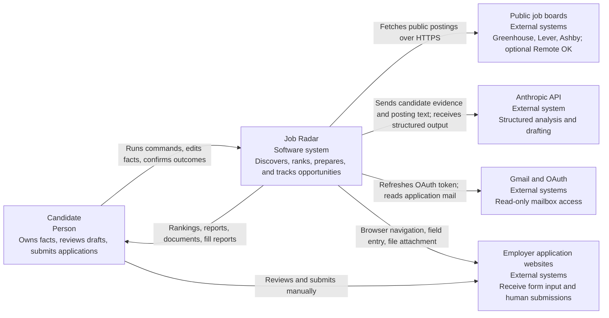
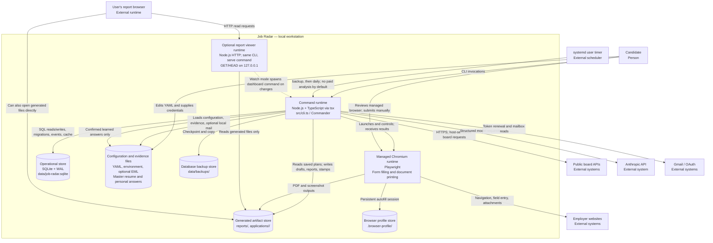
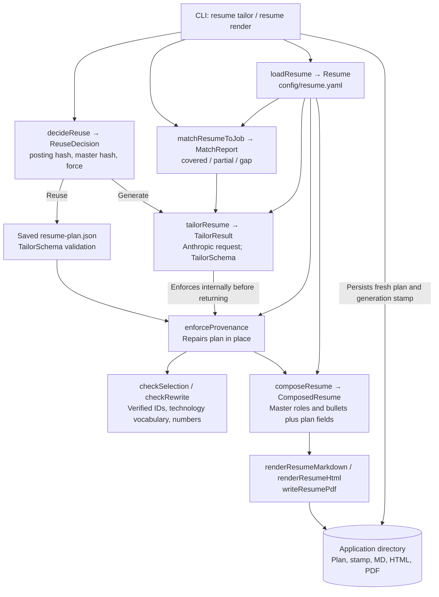
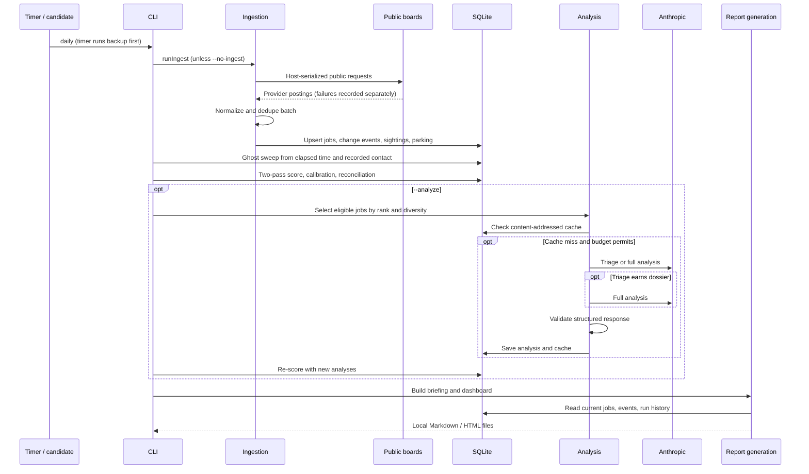

# Job Radar — C4 architecture map

**As inspected:** 2026-09-25, commit `0ff450c`. **Scope:** implemented architecture and checked-in deployment/configuration, not the running user's installation.

Job Radar is a **local, single-user modular monolith**. A TypeScript CLI runs deterministic job processing, selective paid model calls, application preparation, and outcome tracking. SQLite holds operational state; local files hold candidate facts and generated documents. An optional HTTP process serves generated reports.

The diagrams use GitHub-compatible Mermaid flowcharts with explicit C4 element types. A **container** here means a runtime or data store, not a Docker container. C3 components are described as **modules** below. Arrows describe requests, calls, or data movement as labelled; they do not imply separate deployments.

- [C1 — System context](#c1--system-context)
- [C2 — Containers](#c2--containers)
- [C3 — CLI modules](#c3--cli-modules)
- [C4 — Resume preparation code](#c4--resume-preparation-code)
- [Dynamic views](#dynamic-views)
- [Deployment and ownership](#deployment-and-ownership)
- [Architectural review](ARCHITECTURE_REVIEW_2026-09-25.md)

## C1 — System context

**Current configuration:** Greenhouse, Lever, and Ashby are enabled. Remote OK's adapter exists but is disabled in `config/sources.yaml`; attribution remains required if it is enabled. Watchlist companies produce manual research reminders, not network ingestion.

**External data exposure:** paid requests include candidate information and job text. Autofill sends field values and attachments to employer pages before any human submission; “never submits” does not mean “no network activity.” Gmail access reads mail; OAuth token renewal uses POST, while mailbox requests use GET.

## C2 — Containers

The command runtime and report viewer are two invocation modes of the **same package**, not separately built applications. SQLite is embedded, not a database server. Chromium is a child runtime: autofill uses a persistent profile, while PDF rendering uses a separate browser launch.

The static HTTP request handler has no database interface. In watch mode, orchestration watches source files and the database/WAL and spawns a separate `dashboard` CLI process. That process reads SQLite and rewrites `reports/latest.html`; `JOB_RADAR_NO_RUN_LOG=1` suppresses its run-log feedback loop.

### Container responsibilities

| Container / store | Responsibility | Implementation |
|---|---|---|
| Command runtime | Command parsing, workflow sequencing, lifecycle, human confirmation | [`src/cli.ts`](../src/cli.ts) |
| Report viewer | Static report/archive requests, optional refresh header | [`src/report/serve.ts`](../src/report/serve.ts), [`watch.ts`](../src/report/watch.ts) |
| Managed browser | Fill forms without submitting; print HTML to PDF | [`src/apply/autofill.ts`](../src/apply/autofill.ts), [`src/resume/render.ts`](../src/resume/render.ts) |
| SQLite | Current jobs, sightings, events, model cache, runs, mail outcomes, interviews | [`src/db/schema.ts`](../src/db/schema.ts), [`index.ts`](../src/db/index.ts) |
| Evidence/configuration files | Search policy, source list, resume facts, personal answers, credentials | [`src/config/`](../src/config/), [`src/resume/load.ts`](../src/resume/load.ts) |
| Artifact files | Reusable generation plans, packs, stamps, rendered documents, reports | [`src/apply/reuse.ts`](../src/apply/reuse.ts), [`src/analysis/prepare.ts`](../src/analysis/prepare.ts) |

## C3 — CLI modules

This is the decomposition **inside the command runtime**. Report generation is here; HTTP serving remains in C2.

```mermaid
flowchart TB
    boards["Public boards"]
    ai["Anthropic API"]
    mail["Gmail or EML files"]
    browser["Chromium"]
    files[("Generated files")]
    db[("SQLite")]

    subgraph runtime["Command runtime — Node.js / TypeScript"]
        commands["Command orchestration<br/>cli.ts<br/>withRepo; daily; apply; tailor; autofill"]
        config["Configuration module<br/>config/*; resume/load.ts<br/>YAML validation and environment"]
        sources["Discovery and source adapters<br/>sources/*; lib/http.ts<br/>SourceJob; PoliteFetcher"]
        ingest["Ingestion module<br/>pipeline/ingest, normalize, dedupe<br/>NormalizedJob; merge and parking"]
        scoring["Scoring module<br/>pipeline/filters, score, calibration, rescore<br/>Eligibility; fit; ROI; reconciliation"]
        analysis["Analysis module<br/>analysis/analyzer, prompt, schema, detail<br/>Triage; dossiers; validation; cache; spend"]
        resume["Resume module<br/>resume/*<br/>Match; selection plan; provenance; render"]
        pack["Application-pack module<br/>analysis/application, prepare<br/>Structured drafts and document files"]
        artifacts["Artifact reuse module<br/>apply/reuse, resume-file<br/>Generation stamps and file choice"]
        fill["Form-filling module<br/>apply/autofill, fields, learn, record<br/>Decisions; browser control; refusals"]
        inbox["Outcome ingestion module<br/>inbox/*<br/>Classify; match; transition; ghost sweep"]
        reports["Reporting module<br/>report/daily, html, dashboard; stats/*<br/>Briefing, funnel, trends, diagnostics"]
        repo["Persistence module<br/>db/repo, index, schema<br/>JobRepo; SQL and migrations"]
        model["Shared domain contracts<br/>model/*<br/>Job and analysis types; status; freshness"]
    end

    commands --> config
    commands --> ingest
    commands --> scoring
    commands --> analysis
    commands --> resume
    commands --> pack
    commands --> artifacts
    commands --> fill
    commands --> inbox
    commands --> reports
    commands --> repo
    ingest --> sources
    sources -->|"HTTPS"| boards
    ingest --> repo
    scoring --> repo
    scoring -->|"Calibration persistence uses DB directly"| db
    analysis --> repo
    analysis -->|"SDK requests"| ai
    resume -->|"SDK requests for import and tailoring"| ai
    resume -->|"PDF printing"| browser
    resume --> files
    pack -->|"SDK requests"| ai
    pack --> files
    artifacts --> files
    fill --> browser
    fill --> files
    inbox --> mail
    inbox --> repo
    reports --> repo
    reports --> files
    repo --> db
    ingest -.-> model
    scoring -.-> model
    analysis -.-> model
    resume -.-> model
    fill -.-> model
    inbox -.-> model
    repo -.-> model
```

Solid arrows show calls/I/O; dashed arrows show selected shared-contract dependencies. Ubiquitous utility imports are omitted. The diagram is not a claim of enforced layering: the CLI owns substantial business sequencing, the repository includes selection policy, and calibration receives a raw database handle.

### Important interfaces

| Seam | Interface and meaning |
|---|---|
| Provider → normalization | `JobSource.fetch(ctx): Promise<SourceJob[]>`; adapters map fields and record their own failures |
| Normalization → storage | `normalizeJob` produces `NormalizedJob`; `dedupeBatch` selects canonical candidates; `JobRepo.upsert` persists them |
| Deterministic processing → model | `EnrichedJob`, stable system prompt, bounded posting text, deterministic evidence note |
| Model → stored verdict | Provider JSON Schema plus local Zod validation in `analyzeOne`; triage has a distinct schema |
| Resume model → rendering | `TailorPlan` IDs and rewrites, repaired by `enforceProvenance`, resolved by `composeResume` |
| Answer policy → browser | `decide` / `chooseOption` in `apply/fields.ts`; browser implementation performs only the approved actions |
| Mail provider → outcome processing | `MailSource.fetch` produces `Email[]`; Gmail and local EML are actual adapters at this seam |
| Human → application status | Explicit CLI status commands and post-browser confirmation; filling is not submission evidence |

**Important limitation:** the resume seam is the intended safety mechanism, but currently also admits unchecked headline/summary prose and cross-role bullet selection. See review finding R1; this map does not assert complete provenance enforcement.

## C4 — Resume preparation code

A focused code-level view is more useful here than a class diagram of the whole procedural codebase.

`resume render` uses the saved plan directly after schema validation, then re-checks provenance; it does not buy a new plan. `resume tailor` decides between reuse and generation. Master-resume changes deliberately reuse selection and re-check citations, rather than silently selecting different bullets for an already reviewed document.

## Dynamic views

### Daily discovery and ranking

`analyze` alone saves analyses but does not run the second scoring pass; `daily --analyze` does. `daily` does not scan Gmail. Triage is enabled in current configuration; `dossier_for` includes both apply verdicts and `network_or_watch`, with an additional fit-based routing rule.

### Application preparation and outcomes

1. **`resume tailor`:** load master → check posting/verdict → match → reuse or buy plan → enforce provenance → render documents.
2. **`apply`:** check posting/verdict → reuse or buy pack → write JSON/Markdown/HTML and cover-letter files → advance eligible early statuses to `APPLY`.
3. **`autofill`:** load personal facts and saved pack → choose attachment files → launch ordinary Chromium → discover form → fill approved fields → write report/screenshot → stop for human review.
4. **Human:** reviews, supplies omitted answers, optionally submits, closes browser. CLI offers to save learnable answers and asks whether to record `APPLIED`.
5. **`inbox --apply`:** fetch mail → deterministic classification and unambiguous job matching → allowed local status transitions and email-event records. Default `inbox` reports proposed changes only.
6. **Reports:** read current statuses and event history to show progress. Elapsed-time ghosting is a separate daily policy.

There is no automatic command chain requiring a tailored resume before a pack or a pack before autofill. These commands can be invoked independently; autofill warns about missing material and can use a generic resume.

## Deployment and ownership

### One-workstation deployment

- Runtime: Node **>=22.12.0** per `package.json`, `tsx`, native `better-sqlite3`, and Playwright Chromium for browser/PDF paths.
- Scheduling: checked-in user timer at **07:15**, up to **20 minutes** randomized delay, `Persistent=true`; service timeout **45 minutes**.
- Checked-in service runs **backup with retention 14 → daily**, without `--analyze` or `inbox`. Installer adapts local paths/runtime. This is a deployment template, not proof the timer is installed or active.
- Optional viewer binds to loopback by default; the CLI exposes no host override or write endpoints. Generated pages are self-contained and script-free.
- Environment overrides cover the database, search profile, sources, and reports; application and browser-profile paths remain rooted in the project.

### Data ownership and lifecycle

| Data | Owner / source of truth | Lifecycle |
|---|---|---|
| Search constraints and ranking policy | `config/career-profile.yaml` | Validated YAML, loaded per CLI process |
| Source catalog | `config/sources.yaml` | Enabled adapters plus manual watchlist |
| Resume facts | `config/resume.yaml` | Verified bullets and stable IDs; human-maintained master |
| Personal answers | `config/personal.yaml` | Nullable unknowns; confirmed learning with backup |
| Current opportunity | `jobs` | Canonical row updated by ingest, scoring, analysis, and status commands |
| Source sightings | `job_sources` | URLs and first/last observations for records reaching upsert |
| History | `job_events` | Selected discovery/change/analysis/status events; not an event-sourced reconstruction of all state |
| Analysis reuse | `analysis_cache` | Key: material hash + title + company + model + evidence version + tier |
| Document reuse | `applications/<job>/generation.json` | Byte description hash, master hash, timestamp, pack scope; separate from model cache |
| Mail decisions | `email_events` | Message ID dedupe, evidence snippets, resolution, local status effect |
| Operational telemetry | `runs` | Command start/finish, success flag, command-specific JSON statistics |
| Interviews | `interviews` | Human-entered interview records |
| Calibration and schema metadata | `schema_meta` | Derived scoring correction and schema metadata |
| Reports | `reports/` | Rebuildable rolling files and dated briefing archives |
| Backups | `data/backups/` by default | Checkpoint/copy of SQLite; not a backup of resume/personal/artifact files |

### Guarantees to preserve and qualifications

- Keep salary/date/location/seniority parsing, dedupe, hard filters, and scoring arithmetic deterministic.
- Preserve schema validation of paid outputs, content-addressed reuse, prompt caching, and description budgets.
- Preserve three-state requirement matching and repair-to-master provenance behavior. Strengthen the gaps in R1 rather than relaxing checks.
- Preserve refusal of demographics, attestations, unknown personal values, all checkbox ticking, uncertain dropdown matches, and active bot challenges.
- Preserve the distinction between **fill**, **human submit**, and **record outcome**.
- Additive startup migrations and explicit destructive migrations are separate. Multi-write atomicity and backup consistency still need work; see the review.
- Source failure isolation exists at fetch time. Freshness currently groups by provider rather than individual board, so it does not fully preserve that isolation downstream.
- Analysis budget checks stop after recorded estimated spend reaches the limit; they are not a predictive hard maximum on the invoice.

## Keeping this map current

Update C1/C2 when an external integration, runtime, data store, or deployment mode changes. Update C3/C4 when ownership or a caller-visible interface changes. Keep roadmap proposals out of the current-state diagrams until implemented. The companion review contains proposed seams and verification criteria.
